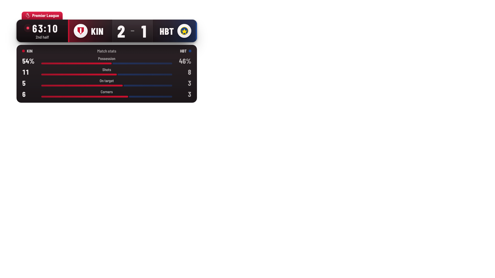

# Overlay hub

One control app and one OBS link for all your stream overlays. You set each overlay up, check it in the preview, then put it on screen. The first overlay is a live football scoreboard that follows a real match by itself from ESPN’s free data, or can be run completely by hand. More overlays plug into the same hub later.


| Address | What it is |
| --- | --- |
| `/control` | The hub, for phone or laptop: every overlay, the preview monitor and each overlay’s controls |
| `/overlay` | The one page OBS shows: 1920×1080, see-through, every overlay on it |

Both pages connect to one small server (Node.js with Express and ws). Every change goes to every open page over a WebSocket straight away, from any device.

## The hub

- **Tiles.** Each overlay is a rounded tile with its live status (for the scoreboard, the score and minute) and a **Show / Off** switch. Tap a tile to open its page. Lower third, Countdown and Alerts are placeholders for overlays still to come.
- **Back arrow.** Each overlay’s page has a back arrow at the top left, and tabs for its settings.
- **Preview monitor.** A plain, square 1920×1080 screen.
  - **Live output** shows exactly what viewers see. **Preview** shows overlays as if they were on screen, so you can set one up before it goes live.
  - Opening an overlay that’s off screen switches to Preview; putting it on screen switches back to Live output.
  - The background can be **Checker** (see-through), **Dark** or **Light**. **Safe area** draws the edge that TVs and phones might crop.
- **Undo.** Goals, red cards, period changes, setting the clock and New match show a pop-up with **Undo**. If a goal is undone, its animation is dropped or cut short on stream too.
- **Pop-ups** when ESPN finds a goal or a red card, or another device makes one.
- **Keyboard shortcuts** on a laptop. They don’t work while you’re typing in a box.

| Key | What it does |
| --- | --- |
| Space | Start or pause the match clock |
| H / A | Goal for the home / away team |
| O | Put the scoreboard on or off screen |
| P | Switch the monitor between Live output and Preview |
| U | Undo |
| 1 to 4 | Match, Stats, Teams, Layout tabs |
| Esc | Back to all overlays |

- New overlays start **off screen**, and the hub remembers your tab, competition and preview settings on each device.

## The live scoreboard


- **Follow a match.** Pick a competition and a day, find a team if you like, and press **Follow**. Competitions: Premier League, Championship, League One, League Two, FA Cup, Carabao Cup, Champions League, Europa League and Conference League. Team names, codes, the kits each side is wearing, official crests and kick-off fill in by themselves.
- From then on the scoreboard follows the match: score and scorers, penalties and own goals, red cards, stats, the period and the clock, extra time and penalty shoot-outs.
- **Official logos.** Club crests and competition logos come from ESPN, so every team ESPN has a crest for gets it. A few non-league clubs have none on ESPN; they get a coloured badge, and you can upload a crest in **Teams**.
- **Goal button.** Press **Goal** the moment it goes in and the animation plays straight away. When ESPN has it, the overlay shows who scored.
- **Manual.** One switch stops ESPN completely; nothing changes unless you change it.
- **Stats you choose.** Up to 8 of 14: possession, shots, on target, corners, fouls, yellow cards, offsides, saves, blocked shots, passes, pass accuracy, tackles, interceptions and crosses. Stats from ESPN update by themselves.
- **Big stats card** comes up at half-time, before extra time and at full-time, with scorers and red cards.
- **Layout.** Overall size, plus sizes and positions for the scoreboard and the big card. You can drag both in the preview.



### How fast it updates

While it follows a match, the server checks ESPN **every 3 seconds**, all match long, half-time included. ESPN only holds this data for a second before refreshing it, so a goal reaches the overlay within about 3 seconds of ESPN having it. In a test against a stand-in for ESPN’s data, goals reached the OBS overlay 0.1 to 2.4 seconds after they appeared.

- Each check is a small request (about 12 KB) for the one match.
- The big match summary (kits, exact half start times, the rest of the stats) loads alongside, every 30 seconds and straight away at kick-off, half-time and the second half, so it never holds up a goal.
- The clock is lined up with the moment ESPN says each half started, so it doesn’t drift. Use the nudge buttons to line it up with a TV picture that runs behind.
- Before kick-off it checks every 2 minutes, every 30 seconds from 3 hours before, and every 3 seconds from 30 minutes before.
- After full-time it checks every 10 seconds for 3 minutes in case ESPN corrects anything, then stops. **Update now** still works.
- If ESPN doesn’t answer, it tries again after 3 seconds, then backs off up to 30 seconds. If ESPN asks for fewer requests, it slows to every 30 seconds for a minute and says so.
- You can choose 3, 5, 10 or 30 seconds in the Match tab. 3 is the fastest and the default.

ESPN’s data is free and needs no key or account, but it isn’t an official public API. ESPN could change it or limit it without warning. If that happens, switch to **Manual** and carry on by hand.

### How live and manual work together

- Goals and red cards you press by hand stay on screen for up to 5 minutes while ESPN catches up. If ESPN never shows them (a goal ruled out by VAR, say), they come off by themselves.
- Taking a goal or card off with **−1** or by tapping it keeps it off, even if ESPN still has it.
- If you end a half before ESPN does, your choice holds for 3 minutes while ESPN catches up.
- Typing a colour or uploading a crest yourself stops ESPN replacing it.

## Try it on your computer

You need Node.js 18 or newer.

```bash
npm install
CONTROL_KEY=pick-a-key npm start
```

Open http://localhost:8080/control, and http://localhost:8080/overlay in another window.

On Windows PowerShell: `npm install`, then `$env:CONTROL_KEY="pick-a-key"; npm start`

## Put it on GitHub

Upload everything in this folder to the repository and keep the layout: `server.js`, `espn.js`, `package.json`, `package-lock.json` and `Dockerfile` at the top, the pages in `public/`, the screenshots in `docs/`. Don’t upload `node_modules` or `data`; they’re made on the server.

**Updating from the old scoreboard:** delete `feed.js`, `public/control.js` and `public/control.css` from the repository, then upload the new files over the top. `package-lock.json` must be there, because the build installs Express and ws from it.

## Deploy on Northflank

1. Connect your GitHub account to Northflank.
2. Create a new service and choose **Combined**, so it builds and deploys every time you push.
3. Pick the repository and branch, and choose **Dockerfile** as the build type.
4. Check the port: the Dockerfile exposes **8080**. It should be HTTP and public. WebSockets work on it as normal.
5. Add a runtime variable `CONTROL_KEY`: a password. Whoever runs the hub types it in once on each device.
6. Optional: add a health check on the path `/healthz`.
7. Optional: attach a volume mounted at `/app/data`, so the overlays, teams and crests survive restarts and redeploys. Without one, they reset when the service restarts.
8. Deploy. The hub is at `https://<your service address>/control` and the overlay at `https://<your service address>/overlay`.

If the service still has `API_FOOTBALL_KEY` or `RAPIDAPI_KEY` from the old version, you can delete them. Nothing uses them now.

Run a single instance. The overlays live in the server’s memory, so two instances would each keep their own copy.

## Add it to OBS

1. Add a **Browser** source.
2. Set the URL to `https://<your service address>/overlay`.
3. Set the width to `1920` and the height to `1080`.

That one source shows every overlay in the hub. If the connection drops, the clock keeps running and the page reconnects by itself. After an update, right-click the source, choose **Properties**, and press **Refresh cache of current page**.

## Settings

| Variable | What it does |
| --- | --- |
| `CONTROL_KEY` | Password for making changes. Without it, anyone with the hub link can change your overlays. |
| `MATCH_TIMEZONE` | Time zone for kick-off times. Default `Europe/London`. |
| `PORT` | Port to listen on. Default `8080`. |
| `DATA_DIR` | Where everything is saved. Default `data/` next to `server.js`. |
| `ESPN_BASE` | Only for testing against a stand-in ESPN server. Leave it unset. |

## Adding another overlay later

Each overlay has the same four parts:

1. A renderer that draws it into the 1920×1080 stage (like `public/scoreboard.js` and `public/scoreboard.css`).
2. An entry in `public/overlays.js`, so the OBS page and the hub load it.
3. Its state on the server: an entry in `modules` in `server.js`, with its defaults and what the hub may change.
4. Its tile and page in the hub: an entry in `TILES` in `public/hub.js`, a `view…` section in `public/control.html`, and its controls in their own script (like `public/scoreboard-control.js`) that call `Hub.module()`.

The hub already handles the preview, Show / Off, saving, undo, pop-ups and keeping every device in step.

## Files

```
server.js                     the server: pages, WebSocket updates, saving, overlay state
espn.js                       ESPN live data: match lists, following one match, goals, cards, stats, clock
public/overlay.html           the page OBS shows, with every overlay
public/control.html           the hub
public/hub.js                 the hub: tiles, preview monitor, back arrow, undo, pop-ups, shortcuts, sync
public/hub.css                hub styles
public/connect.js             the WebSocket link, with automatic reconnects
public/stage.js               the 1920×1080 stage every overlay draws into
public/overlays.js            the list of overlays
public/match.js               scoreboard rules shared by the server and the pages
public/scoreboard.js          draws the scoreboard overlay
public/scoreboard.css         scoreboard overlay styles
public/scoreboard-control.js  the scoreboard's page in the hub
Dockerfile                    build for Northflank or any Docker host
```

Fonts come from Google Fonts (Barlow), and crests and logos from ESPN, so the OBS machine needs internet access, which a stream has anyway.
