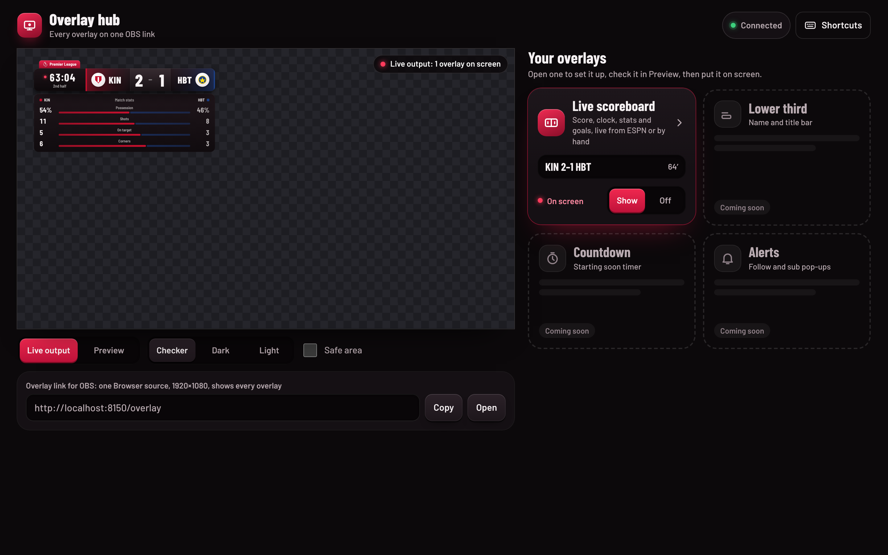
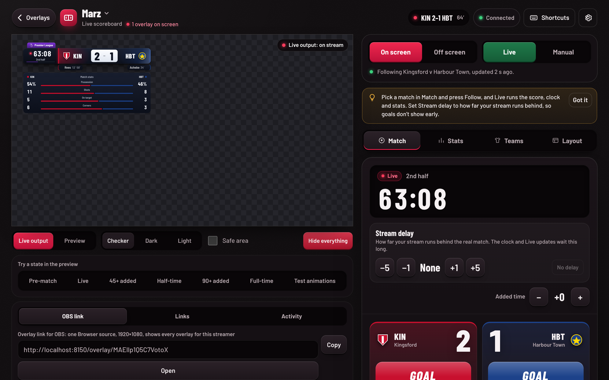
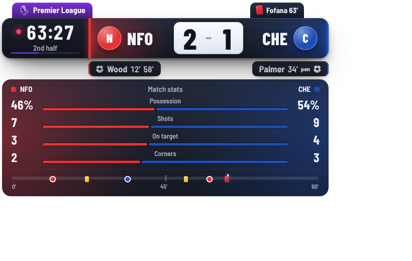
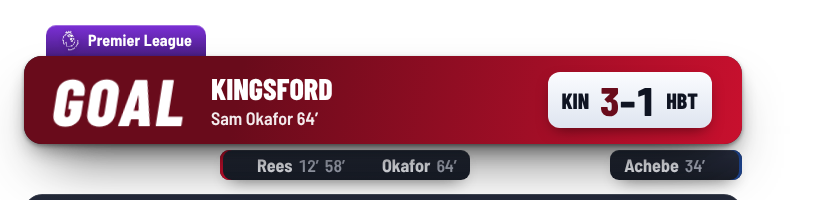

# Overlay hub

One control app for all your stream overlays, for one streamer or several. Each streamer gets their own overlays, their own OBS link and their own live match. You're the owner; editors you approve can run overlays for the streamers you choose. You set an overlay up, check it in the preview, then put it on screen. The first overlay is a live football scoreboard that follows a real match from ESPN’s free data, or runs completely by hand.



| Address | What it is |
| --- | --- |
| `/control` | The hub, on phone or laptop |
| `/overlay/<code>` | A streamer’s OBS page: 1920×1080, see-through, every overlay of theirs. Copy it from the hub. |
| `/overlay` | The old link. It keeps showing the first streamer until you reset that streamer’s link. |

The server is Node.js with Express and ws. Changes reach every open page over a WebSocket straight away. Only what changed is sent, compressed, so traffic stays tiny.

## Streamers

- **Switch streamer** from the name at the top left. Everything below it (tiles, preview, controls, the OBS link) switches to that streamer. A red dot in the list means something of theirs is on screen.
- **Add streamer** in the same menu. New streamers start with everything off screen.
- **Manage streamers** to rename one, copy their OBS link, reset their link, or remove them.
  - **Reset link** makes a new link and stops the old one working straight away. Use it if a link gets shared by mistake, then paste the new link into that streamer’s OBS.
  - **Remove** deletes the streamer and everything of theirs.
- Each streamer’s live scoreboard is completely separate: their own match, score, clock, teams, layout and stream delay. If two streamers follow the same match, the server asks ESPN once and shares the answer.
- The hub holds up to 10 streamers and 30 connected devices at once, to stay inside the free plan.

## Finding your way

- **Every overlay has the same three buttons:** **Off** and **Show preview**, then **Show on screen** once it's in preview. That covers the scoreboard, each Canvas item, your drawing and each Stream Desk widget.
- **Preview** means it shows in the hub's preview with a dashed yellow outline, but not on stream. **On screen** means viewers can see it. **Off** means it's nowhere.
- **The preview in the hub** always shows what's on screen, plus anything in preview.
- **Move anything** by dragging it on the preview: the scoreboard and its cards, Canvas items and Stream Desk widgets. Sizes are sliders.
- **Hide everything** turns every overlay off, previews included.
- **Every page is grouped into dropdowns,** with only the everyday ones open. The hub remembers what you open.
- **Live** follows a real match from ESPN by itself; **Manual** changes only when you press something.

## People: you and your editors

- **You're the owner.** Sign in on the Owner tab with your `CONTROL_KEY` (or an owner password you set in Settings, Passwords). The `CONTROL_KEY` always works, so you can't lock yourself out.
- **Editors** sign in on the Editor tab with their name and the editor password you give them, then wait. You see their request in Settings, People, and a red number on the cog tells you someone's waiting.
- **When you accept,** you choose:
  - which streamers they can run
  - how long their access lasts: 1 hour, 24 hours, 7 days, 30 days, or never expires
  When it runs out they're locked out and can ask again.
- **A device you've approved** signs back in without asking you again. A new device asks you once.
- **Editors can** run overlays, the scoreboard, teams, sizes and positions for their streamers, and hide everything.
- **Editors can't** use Links, Activity, People, passwords, backups, overlay look, uploads, the ESPN check speed, or add, remove or reset streamers. All of that is hidden from them and refused by the server too.
- **People** also shows who's online, when everyone was last seen, which devices they use, and 30 days of sign-in history. Remove someone and they're locked out straight away.
- **Wrong passwords** slow down after a few tries, and requests nobody answers are declined after 24 hours.

## The hub

- **Tiles.** Each overlay is a tile with its live status and a Show / Off switch. Lower third, Countdown and Alerts are placeholders for overlays still to come.
- **Overlay pages.** Each overlay’s page has a back arrow at the top left and tabs.
- **Preview.**
  - **Live output** shows exactly what viewers see. **Preview** shows overlays as if they were on screen, so you can set one up first.
  - The background can be Checker, Dark or Light, and **Safe area** shows the edge that might get cropped.
- **Undo** after goals, red cards, period changes, setting the clock and New match.
- **Pop-ups** when a goal or red card comes in from Live or another device.
- **Updates.** After an update, the OBS overlays reload themselves. The hub offers a Reload button.
- **Mini score.** The score and minute stay in the top bar on every page.
- **Hide everything,** next to the preview controls, takes every overlay for the current streamer off screen at once.
- **Under the preview:** three tabs.
  - **OBS link:** the streamer's overlay link.
  - **Links** (owner only): your streaming and production links as buttons that open in a new tab. Add, reorder or remove them there.
  - **Activity** (owner only): everything that happened on this streamer, with who did it: you, an editor, or Live.
- **Hide link.** Manage streamers has a Hide link for each streamer: a one-button page they can keep on their phone to take their own overlays off screen, without signing in.
- **Tiles** show a small live picture of each overlay.

## Canvas

Draw and place things on the stream, on the same OBS link.

- **Draw on the preview:**
  - pen in 6 colours and any thickness, arrows, an eraser (tap a line), undo and clear; your drawing has its own Off, Show preview and Show on screen
  - fading ink that disappears after a few seconds
  - a laser pointer that shows only while you hold it
  - a spotlight that dims everything but one spot
- **Add:**
  - text, web pages, YouTube videos and QR codes
  - a tactics pitch to draw plays on, and pictures from the library
  New things start in preview. Drag them where you want them, set the size, optionally a timer that turns them off, then press Show on screen.
- **Library:** the owner uploads pictures (up to 8 MB) and MP3s (up to 30 MB), and must tick that they have the right to use them. Editors can use everything in it but can't add or delete; their files show as locked.
- **Music:** play, pause, next and repeat, with volume.
  - The playlist has a space limit. When a new song won't fit, the oldest unpinned song that isn't playing is removed; pin songs to keep them.
  - To hear music on stream, tick "Control audio via OBS" on the Browser source.
- **Saved boards:** save the drawing and everything placed, and load it again later. Up to 10.

## Stream Desk

Everyday widgets for any stream. Each one is bold floating text with no box, in any colour, and you drag it anywhere on the preview. Each widget is its own dropdown, with the three buttons, a label, a colour and a size:

- **Timer:** xx:xx:xx, counting down from the minutes you set or counting up, with start, pause and reset.
- **Countdown:** xx:xx:xx to a date and time, with optional text for when it hits zero.
- **Counter:** plus and minus, with an optional goal (37 / 50).
- **Text:** still or scrolling.
- **Checklist:** tick things off as you go.
- **Budget list:** items with prices and a budget. What's left turns yellow when it's nearly spent and red when you're over.
- **Clock:** the time where you are, like Miami, with or without seconds.

## Chat (owner)

The Chat tab under the preview reads a streamer's Twitch chat anonymously and read-only: type their channel and press Read chat.

- **Chat commands** are off by default. Turned on, they only work for the Twitch names on your list (marzvise to start with):
  - !show puts the scoreboard on screen
  - !hide takes everything off screen
  - !goalhome and !goalaway add goals, in Manual only
- Twitch could change or stop anonymous chat reading; the rest of the hub carries on without it.

## Settings (the cog)

- **Personal,** for this device only: 5 themes (Crimson, Midnight, Pitch, Ultraviolet, Daylight), big buttons, vibrate on goals, bringing the tips back, and signing out.
- **Tiles:** order them Auto (on screen first, then overlays you can preview, then ones still to come) or Custom, and rename any tile.
- **Overlay look,** for the current streamer: font (Barlow, Oswald or Saira), rounded or sharp corners, how overlays come on and go off (slide, fade or wipe), and the stacking order when overlays overlap.
- **People** and **Passwords:** as above.
- **Backup:** download one streamer or everything as a file, and restore from a file. People and passwords are never in a backup.
  - The hub also keeps a copy on your device every 10 minutes.
  - If the server ever starts empty, a banner offers to put your setup back from that copy.
- **Storage and traffic:**
  - uploads against the 700 MB cap, with each streamer's share
  - this month's traffic against the 8 GB budget, with warnings at 70% and 90%
  At 100%, big files pause until the 1st. Scoreboard updates are tiny, so the scoreboard keeps working.
- **Updating:** tells you whether it's safe to update, which means nobody has anything on screen.

**Built-in links:** put links in `links.json` (like `[{ "name": "Twitch dashboard", "url": "https://dashboard.twitch.tv" }]`). They're added to the Links tab the first time it's empty.

**Backups** don't include uploaded pictures and music; those stay on the volume.

| Key | What it does |
| --- | --- |
| Space | Start or pause the clock (Manual) |
| H / A | Goal for the home / away team |
| O | Put the scoreboard on or off screen |
| P | Switch the monitor between Live output and Preview |
| U | Undo |
| 1 to 4 | Match, Stats, Teams, Layout tabs |
| Esc | Back to all overlays |

## The live scoreboard



**Live and Manual**

- **Live** follows a match from ESPN: score and scorers, penalties and own goals, red cards, stats, the period, the clock, extra time and shoot-outs. The match runs itself, so the manual controls step aside. You keep:
  - Goal and Red, for when you see something first
  - +1 and −1
  - added time
  - the stream delay
- **Manual** never changes by itself and asks ESPN nothing. The clock, period and kick-off controls come back.

**Stream delay**

Your stream runs behind the real match, so Live would show goals before viewers see them. Set how many seconds your stream is behind, and Live waits that long before anything goes on screen. The clock runs the same amount behind. Use the −5, −1, +1 and +5 buttons to line it up with the picture, or No delay to clear it.

**Following a match**

- Pick a competition and a day, find a team, and press **Follow**. The competitions are Premier League, Championship, League One, League Two, FA Cup, Carabao Cup, Champions League, Europa League and Conference League.
- A new match starts completely fresh: nothing (score, cards, stats, names, colours, crests) carries over from the last one. Your layout and your choice of stats stay.
- Kick-off times show in the time zone you pick in Teams.

**Teams and colours**

- **Swatches.** Each team gets colour swatches from ESPN: the kit worn in this match, the club colour, a second colour and the kit trim. Tap one to use it; the kit swatch hands the colour back to Live. **Colour** picks anything else.
- **Crests** are ESPN’s official club crests. If ESPN has none (some non-league clubs), the team gets a coloured badge, and you can upload one.

**On the overlay**



- **Accent colour.** The tab, progress line and card header take the competition’s colour, such as purple for the Premier League or orange for the Europa League. Or set your brand colour under Layout, Look.
- **Score chip.** The score sits in a light chip. A thin line under the clock fills as the half goes on.
- **Team names.** Layout sets the scoreboard to show codes (NFO), short names (Nottm Forest) or full club names (Nottingham Forest). ESPN fills in both names; you can change them in Teams.
- **Scorers under each team,** with a ball icon, like “Rees 12’ 58’”. Layout sets them to Always, After goals (15 seconds after each goal) or Off.
- **The goal moment.** The goal flash slides the new score in. Then the scoring side glows in its colour for about 10 seconds and its crest pops. You can turn the celebration off.
- **Red cards.** The tab over each team shows who got sent off and when, like “Fofana 63’”, and the big card lists them too. Pressed by hand, a red card shows the team until ESPN names the player, then a quick second flash shows who it was.
- **Stats.** Plain bars in each team's colour, under the bar and on the big card.
  - Before kick-off, stats show 0, not dashes.
  - Stats ESPN doesn’t send for a match are left out once it starts, instead of sitting at 0.
- **Broadcast sheen.** A light sweep across the bar every minute or so. You can turn it off.
- **Double-goal check.** A second goal for the same team within 10 seconds asks “Add another?”, so two people pressing at once can’t add two goals.



**Try a state in the preview**

Pre-match counts down to kick-off, Live runs the clock, and the rest show added time, half-time and full-time. **Test animations** plays a goal with the scorer spotlight, the half-time banner, the added time board, a ruled-out goal and a red card. These only change your preview, never the stream.

**Match moments** (each one can be turned off in Layout)

- **Yellow cards** show on the match timeline. The tabs above the scoreboard stay for red cards only.
- **Match timeline:** a 0 to 90 line at the bottom of the stats, with goals and cards where they happened and a marker for the current minute. It goes to 120 in extra time.
- **Banners:** kick-off, half-time, second half, extra time and penalties each get a banner in the competition's colour.
- **Added time board:** "+4 minutes added" flashes when added time goes up.
- **No goal:** if ESPN takes a goal back (VAR or the referee), the score goes back down and a "No goal" flash names the player. A corrected scorer or minute doesn't count as a ruled-out goal.
- **Scorer spotlight:** after a goal with a named scorer, a lower third shows their name, shirt number and team at the bottom left.
- **Full-time splash:** a big full-time moment with both teams, the score and the scorers, then the stats card.
- **ESPN warning:** if ESPN's data ever stops looking like a match, the hub says so and suggests switching to Manual, while Live keeps trying.

**Extras tab**

- **Centre card:** Line-ups (both XIs with shirt numbers and formation), Match info (kick-off, ground, referee), Form (last five results), Head-to-head (recent meetings) and Table (both teams highlighted). They come from ESPN when you follow a match. One shows at a time, where the stats card sits; press it again to take it off.
- **Other scores ticker** along the bottom: the rest of today's games in the same competition, updated once a minute.
- **Substitutions:** a small flash with who's on and who's off, from ESPN.
- **Penalty shoot-out:** a dot per kick under each team during penalties. Live fills it in; you can also tap Scored or Missed.
- **Autopilot:**
  - puts the scoreboard on 15 minutes before kick-off with Match info or Line-ups
  - takes that card off at kick-off
  - takes everything off 5, 10 or 15 minutes after full time
  Anything you change by hand stays, and Hide everything pauses it for 10 minutes.
- **Scenes:** save how the overlay looks (what's showing, the card, the layout) and switch back with one tap. Up to 8.
- **Follow my team** (owner): type a team; when nothing's being followed, the hub finds their match today and follows it by itself, up to 3 hours before kick-off.
- **Practice match:** a pretend match plays in the preview in about a minute. Nothing goes on stream.
- **Scoreboard style** (in Layout): Broadcast, Minimal, Bold or Mini.

**Handy extras**

- **Copy result** (next to Update now) copies a tidy summary for Discord or X: the score, status, scorers, red cards and the stats on show.
- **Quick bar on phones:** Goal home, On screen and Goal away stay pinned at the bottom of the screen.
- **Goal buttons** flash when pressed, and a tick shows next to Connected when a change has saved.

### How fast it updates

While following a match, the server checks ESPN every 3 seconds, half-time included.
- Goals reach the overlay within about 3 seconds of ESPN having them, plus your stream delay.
- When several streamers follow different matches, checks spread out so the server never sends more than about one request a second.
- Before kick-off it checks less often, and every 3 seconds from 30 minutes before.
- After full-time it keeps checking for 3 minutes, then stops.
- **Update now** always asks ESPN fresh.

ESPN’s data is free with no key, but it isn’t an official API and could change without warning. If it breaks, switch to Manual and carry on.

## Updating from the last version

1. Upload every file in this folder over the top of your GitHub repository. Nothing needs deleting.
2. Wait for Northflank to finish deploying, ideally when nobody’s live.
3. Open the hub and sign in on the **Owner** tab with your `CONTROL_KEY`. The old “enter the control key” box is gone, so every device signs in once.
4. To add editors, set an editor password in Settings, Passwords, then give them the hub link and that password.
5. From the version before streamer tabs: your teams and layout move into a streamer called “My stream” by themselves. Your OBS keeps working on the old `/overlay` link until you swap in the new one from the OBS link tab.

## PC mode: a free backup on your own computer

If the online server ever has a problem mid-stream, run the hub on your streaming PC instead.

1. Install Node.js 18 or newer from nodejs.org, once.
2. Double-click **start-pc-mode.bat** on Windows, or **start-pc-mode.command** on a Mac. The first run installs what it needs.
3. Type a control key when it asks. The hub opens in your browser; sign in on the Owner tab with that key.
4. Restore your setup in Settings, Backup: from a backup file, or from this computer's own copy if you've used the hub here before.
5. In OBS, point the Browser source at `http://localhost:8080/overlay/<code>` (copy it from the OBS link tab).
6. Your phone can control it on the same Wi-Fi with one of the "On your network" links shown in the window.

## Try it on your computer

You need Node.js 18 or newer.

```bash
npm install
CONTROL_KEY=pick-a-key npm start
```

Open http://localhost:8080/control. On Windows PowerShell: `npm install`, then `$env:CONTROL_KEY="pick-a-key"; npm start`

## Put it on GitHub

Upload everything in this folder and keep the layout: `server.js`, `espn.js`, `package.json`, `package-lock.json` and `Dockerfile` at the top, the pages in `public/`, the screenshots in `docs/`. Don’t upload `node_modules` or `data`.

## Deploy on Northflank (free plan)

1. Connect GitHub to Northflank and create a **Combined** service from the repository, with **Dockerfile** as the build type.
2. Keep port **8080** as a public HTTP port. WebSockets work on it as normal.
3. Pick the smallest plan that runs it smoothly; 512 MB is a safe size and well inside the free allowance.
4. Add the runtime variable `CONTROL_KEY`. That’s your password for the hub.
5. Attach a **1 GB volume** at `/app/data`, so streamers, overlays, teams and crests survive restarts and updates.
6. Optional: a health check on `/healthz`.

Run a single instance; everything lives in the one server’s memory.

## Add it to OBS

1. Add a **Browser** source.
2. Paste that streamer’s link from the OBS link box under the preview.
3. Set the width to `1920` and the height to `1080`.

The source shows every overlay for that streamer. If the connection drops, the clock keeps running and it reconnects by itself. After an update it reloads itself, so you don’t need to refresh it.

## Settings

| Variable | What it does |
| --- | --- |
| `CONTROL_KEY` | Password for the hub. Without it, anyone with the link can change your overlays. |
| `MATCH_TIMEZONE` | Default time zone for kick-off times on new streamers. Default `Europe/London`. |
| `PORT` | Port to listen on. Default `8080`. |
| `DATA_DIR` | Where everything is saved. Default `data/` next to `server.js`. |
| `ESPN_BASE` | Only for testing against a stand-in ESPN. Leave it unset. |

## Adding another overlay later

Each overlay has four parts:
1. A renderer that draws into the 1920×1080 stage (like `public/scoreboard.js` and `public/scoreboard.css`).
2. An entry in `public/overlays.js`.
3. Its state on the server: an entry in `MODULES` in `server.js`.
4. Its tile and page in the hub: `TILES` in `public/hub.js`, a section in `public/control.html`, and its controls in their own script that calls `Hub.module()`.

The hub already handles streamers, the preview, Show / Off, saving, undo, pop-ups and keeping every device in step.

## Files

```
server.js                     the server: streamers, pages, WebSocket updates, saving
espn.js                       ESPN live data: match lists, following a match, stream delay, shared requests
public/overlay.html           a streamer's OBS page
public/control.html           the hub
public/hub.js                 the hub: streamers, tiles, preview, back arrow, undo, pop-ups, shortcuts, sync
public/hub.css                hub styles
public/connect.js             the WebSocket link: changes only, reconnects, reloads after updates
public/stage.js               the 1920×1080 stage every overlay draws into
public/overlays.js            the list of overlays
public/match.js               scoreboard rules shared by the server and the pages
public/scoreboard.js          draws the scoreboard overlay
public/scoreboard.css         scoreboard overlay styles
public/scoreboard-control.js  the scoreboard's page in the hub
public/settings.js            the settings behind the cog: personal, tiles, look, people, passwords, backup, storage, updating
public/canvas.js, canvas-control.js  Canvas: the overlay, and its page in the hub
public/desk.js, desk-control.js      Stream Desk: the overlay, and its page in the hub
public/extras-model.js        the shape of Canvas and Stream Desk, shared by the server and the browser
public/extras.css             Canvas and Stream Desk styles
public/vendor/qrcode.js       QR codes (MIT licence)
chat.js                       reads Twitch chat
links.json                    your built-in links
public/hide.html              each streamer's one-button Hide my overlays page
start-pc-mode.bat / .command  PC mode for Windows and Mac
Dockerfile                    build for Northflank or any Docker host
```

Fonts come from Google Fonts and crests and competition logos from ESPN, so the OBS machine needs internet access.

## Chat Games

The Chat Games tab runs games your Twitch chat plays. Chat is read from the streamer's channel in the Chat tab; adding a streamer sets that channel from their name automatically.

- **Poll**: a question with 2 to 4 answers. Chat votes by typing 1, 2, 3 or 4, one vote each, and can change it.
- **Contexto**: you type a secret word (or tap Random word). Every guess in chat gets a number for how close it is in meaning; 1 is the word itself, and the first person to get it wins. Give a hint if chat gets stuck.
- **Flag game**: a flag shows on stream and the first person to name the country wins the point. 190 flags, including England, Scotland, Wales and Northern Ireland. The next flag can come up by itself.
- **Giveaway**: viewers type the entry word (normally !join), one entry each, and a winner is drawn at random.
- **Scavenger hunt**: a square grid of things to find (3 by 3, 4 by 4 or 5 by 5) that you tick off.

Guesses: any single word counts while a game runs, or switch to "Only !g word" so normal chat doesn't count.

The word list (wordlist/, about 1 MB, made from the free GloVe word set) and the flags (wordlist/flags.json, all 190 in one file of about 1.4 MB so the project stays under GitHub's 100-files-per-upload limit, from the open-source flag-icons set, MIT licence) are part of the app. They don't use your 700 MB upload space, and viewers only ever download the one flag on screen.

## Editors and what they can see

In Settings, People, you choose for each editor which streamers they can run and which tabs they can use (Live scoreboard, Canvas, Stream Desk, Chat Games). The server enforces it: an editor's hub never receives the other tabs, and any change they try there is refused. Changes reach their screen straight away.

Editors never see the OBS link or the Hide link, so they can't copy or pass them on. They also can't see Links, Activity, Chat, People, settings or uploads. People approved before tab choices existed keep every tab until you untick some.
